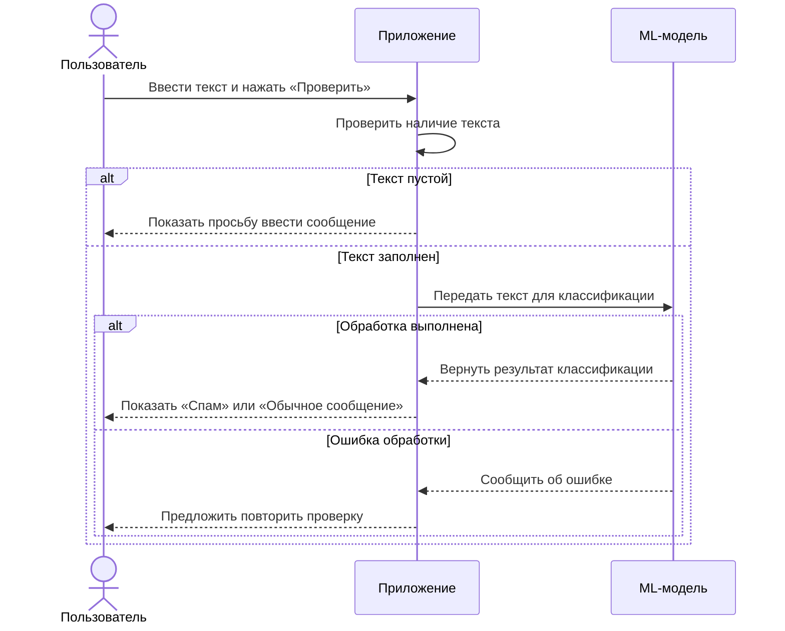
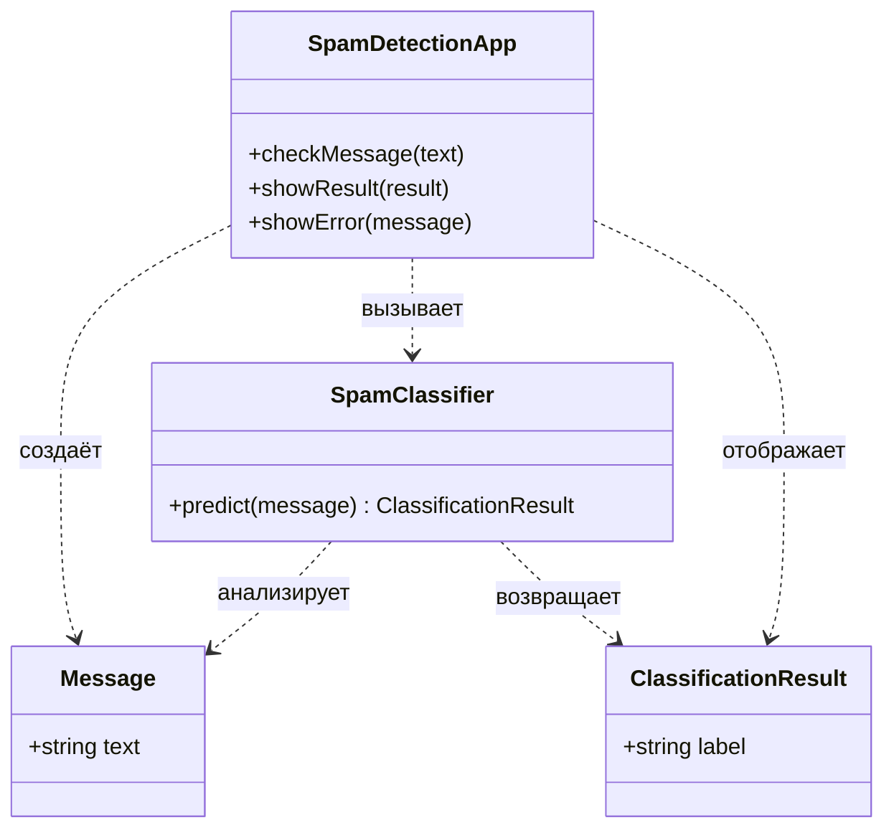

# Диаграммы

## Диаграмма последовательности

Диаграмма показывает выполнение UC-01 — проверку сообщения на спам.

## Диаграмма классов

Диаграмма описывает основные сущности системы:

- SpamDetectionApp — приложение, принимающее текст пользователя;
- Message — проверяемое сообщение;
- SpamClassifier — ML-компонент для определения спама;
- ClassificationResult — результат классификации.

